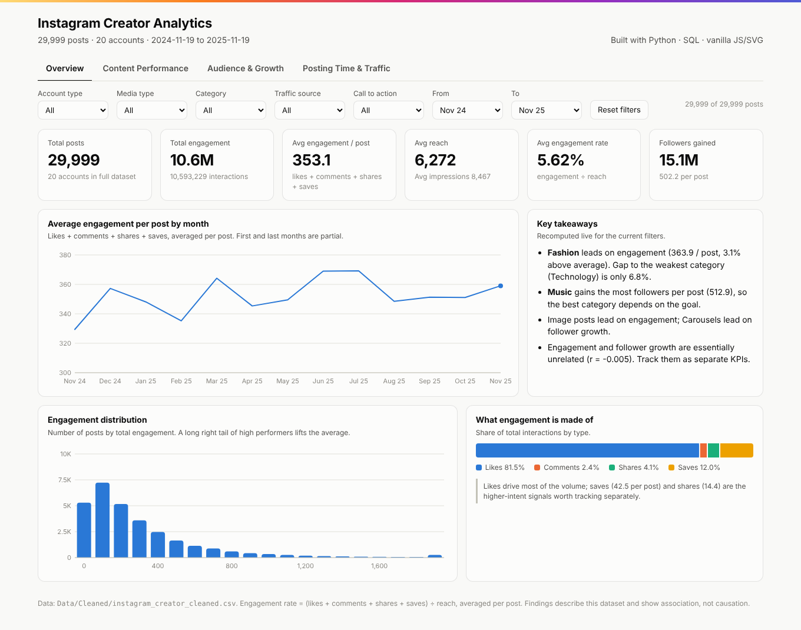
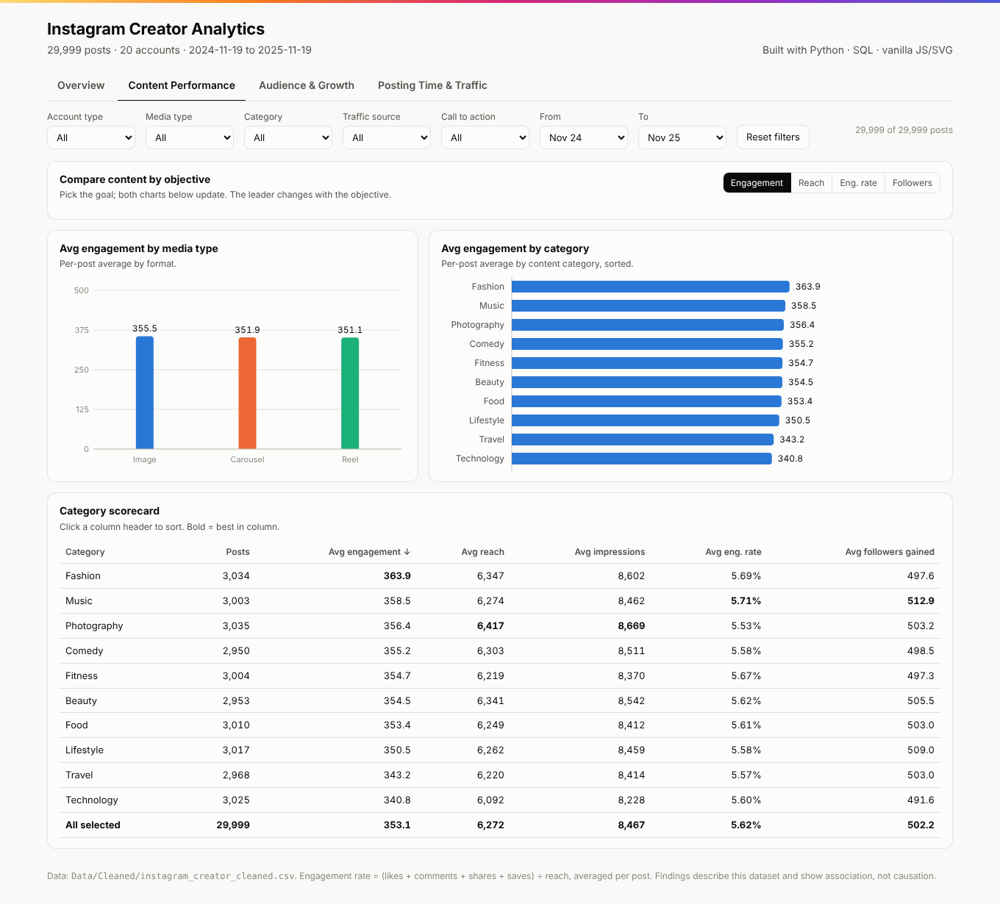
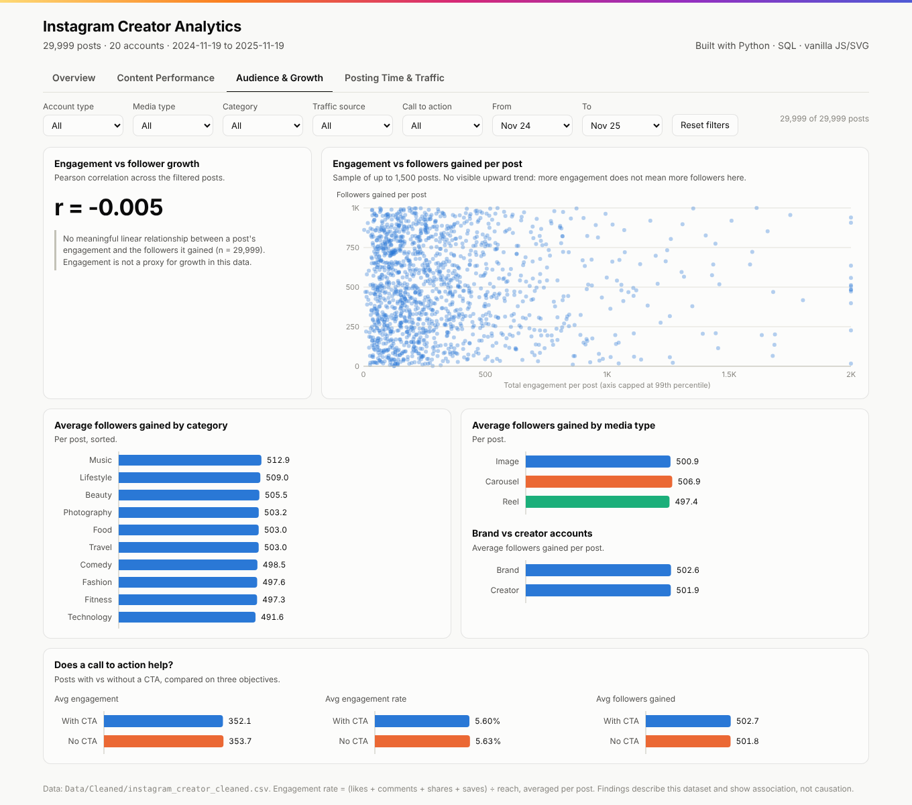
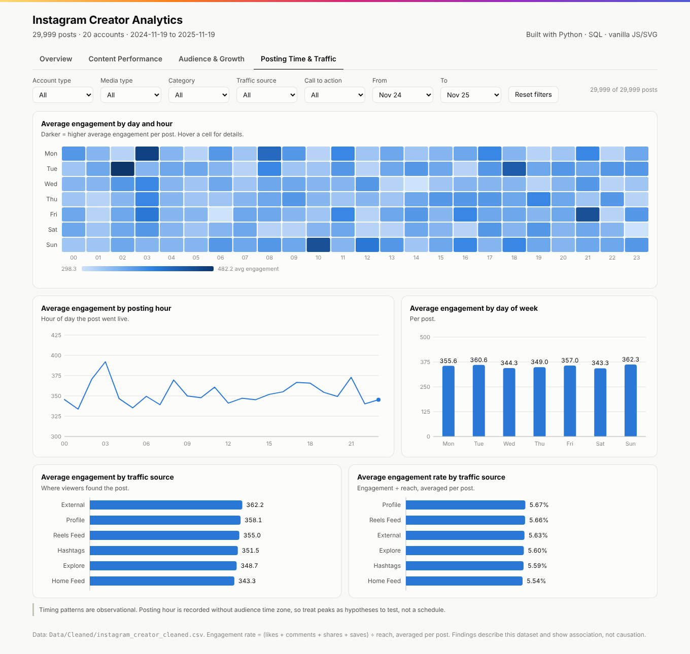

# Instagram Creator Analytics

An end-to-end data analytics project exploring Instagram content performance, audience engagement, reach, impressions, and follower growth using SQL, Python, and an interactive web dashboard.

## Project Overview

This project analyzes Instagram creator post data to identify performance patterns and translate them into actionable content-strategy recommendations.

The analysis examines how media types, content categories, posting times, traffic sources, and calls to action relate to engagement and follower growth.

## Business Objectives

- Measure overall Instagram content performance.
- Compare engagement across media types and content categories.
- Explore relationships between posting time and engagement.
- Evaluate performance across traffic sources.
- Investigate the relationship between engagement and follower growth.
- Develop data-informed recommendations for content strategy.

## Tools & Technologies

| Tool | Purpose |
|---|---|
| Python | Data cleaning, validation, and exploratory data analysis |
| Pandas | Data manipulation and analysis |
| MySQL | Data storage, querying, and SQL analysis |
| Matplotlib | Charts during exploratory analysis |
| HTML, CSS & JavaScript (SVG) | Interactive dashboard with filters |
| Git & GitHub | Version control and project sharing |

## Project Workflow

1. Business understanding
2. Dataset evaluation
3. Data cleaning and validation
4. Database preparation and SQL analysis
5. Python exploratory data analysis
6. KPI analysis and visualization
7. Interactive dashboard development
8. Business insights and recommendations
9. Documentation and project presentation

## Project Structure

```text
instagram-creator-analytics/
├── Data/
│   ├── Raw/                     # original dataset
│   └── Cleaned/                 # analysis-ready dataset
├── Docs/
│   ├── Business_Understanding.md
│   ├── Project_Scope.md
│   ├── Data_Requirements.md
│   └── Insights_Recommendation.md
├── Python/
│   └── data_understanding.ipynb
├── SQL/
│   ├── setup.sql                # creates the database and loads the CSV
│   └── analysis.sql
├── Dashboard/
│   ├── index.html               # interactive web dashboard (open in a browser)
│   ├── dashboard_template.html  # dashboard layout and chart code
│   ├── build_dashboard.py       # rebuilds index.html from the cleaned CSV
│   └── screenshots/
├── .gitignore
└── README.md
```

## Dataset Overview

- **Primary dataset:** 29,999 Instagram post records
- **Original columns:** 23
- **Unique accounts:** 20
- **Cleaned dataset:** 29,999 rows and 25 columns

Data preparation included standardizing column names, parsing date fields, validating records, and deriving total engagement and a calculated engagement rate.

The additional datasets evaluated during the project were not combined with the primary dataset because of duplication, missing identifiers, or conflicting data.

## Key Performance Indicators

| KPI | Result |
|---|---:|
| Total Posts | 29,999 |
| Total Engagement | 10,593,229 |
| Average Engagement per Post | 353.12 |
| Average Reach | 6,272.48 |
| Average Impressions | 8,466.95 |
| Average Calculated Engagement Rate | 5.62% |
| Total Followers Gained | 15,064,082 |
| Average Followers Gained per Post | 502.15 |

## Key Findings

### 1. Content Category
- Fashion recorded the highest average engagement at approximately 363.92 per post.
- Music recorded the highest average follower growth at approximately 512.87 per post.
- Photography achieved the highest average reach among the analyzed categories.

### 2. Media Type
- Image posts recorded slightly higher average engagement than carousels and reels.
- Carousels recorded the highest average follower growth among the three media types.
- The differences in average engagement across formats were relatively small.

### 3. Posting Time
- 3 AM had the highest observed average engagement among posting hours.
- Sunday had the highest average engagement among days of the week.
- These are observed patterns, not proof of a universally optimal posting schedule.

### 4. Traffic Sources
- External traffic had the highest average engagement among the analyzed traffic sources.
- Profile traffic had the highest average calculated engagement rate.

### 5. Engagement vs. Follower Growth
- The correlation between engagement and follower growth was approximately -0.005.
- This indicates almost no linear relationship in this dataset; engagement alone should not be treated as a reliable indicator of follower growth.

## Business Recommendations

- Test content categories and formats against specific goals.
- Track engagement and follower growth as separate performance metrics.
- Experiment with posting windows while considering audience time zones.
- Monitor traffic sources to understand where engagement comes from.
- Evaluate different calls to action rather than assuming their presence guarantees better performance.
- Collect additional metrics, such as profile visits and follower conversion, to better understand growth.

These recommendations are based on observed associations in the available dataset. They do not establish causation.

## Interactive Web Dashboard

A browser-based version of the dashboard lives in [`Dashboard/`](Dashboard/). It is a single self-contained HTML file (no installs, no external libraries) built from the cleaned dataset, with filters for account type, media type, category, traffic source, call to action, and month range. Every chart, KPI, and takeaway recomputes live for the current filters.

**Live demo:** enable GitHub Pages (Settings → Pages → Deploy from branch → `main` / root) and open `https://kashish1422.github.io/instagram-creator-analytics/Dashboard/`. Or download `Dashboard/index.html` and open it in any browser.

| Overview | Content Performance |
|---|---|
|  |  |
| **Audience & Growth** | **Posting Time & Traffic** |
|  |  |

To rebuild after changing the data: `python Dashboard/build_dashboard.py` (requires pandas).

## Project Documentation

- [Business Understanding](Docs/Business_Understanding.md)
- [Project Scope](Docs/Project_Scope.md)
- [Data Requirements](Docs/Data_Requirements.md)
- [Insights and Recommendations](Docs/Insights_Recommendation.md)
- [SQL Analysis](SQL/analysis.sql)
- [Python Analysis](Python/data_understanding.ipynb)

## How to Explore the Project

1. Clone or download this repository.
2. Open `Dashboard/index.html` in a browser (or the GitHub Pages link above) for the interactive dashboard.
3. Run `Python/data_understanding.ipynb` from the `Python/` folder, top to bottom, to reproduce the cleaning and EDA. It writes `Data/Cleaned/instagram_creator_cleaned.csv`.
4. In MySQL, run `SQL/setup.sql` to create the `instagram_creator_analytics` database and load the cleaned CSV, then run the queries in `SQL/analysis.sql`.

**Note:** `SQL/setup.sql` uses `LOAD DATA LOCAL INFILE`. Enable `local_infile` in your MySQL client and server, and update the file path in the script to match your machine.

## Limitations

- Findings describe the available dataset and may not generalize to all Instagram creators.
- Observational patterns do not establish cause and effect.
- Posting-time results can be affected by sample size, audience composition, and other factors.
- More conversion-related metrics would be needed to explain follower growth fully.

## About This Project

This project demonstrates an end-to-end analytics workflow, from data preparation and SQL querying to exploratory analysis, dashboard development, and business recommendations.

**Next step:** rebuild the dashboard in Power BI with DAX measures, using the same KPIs and page structure.